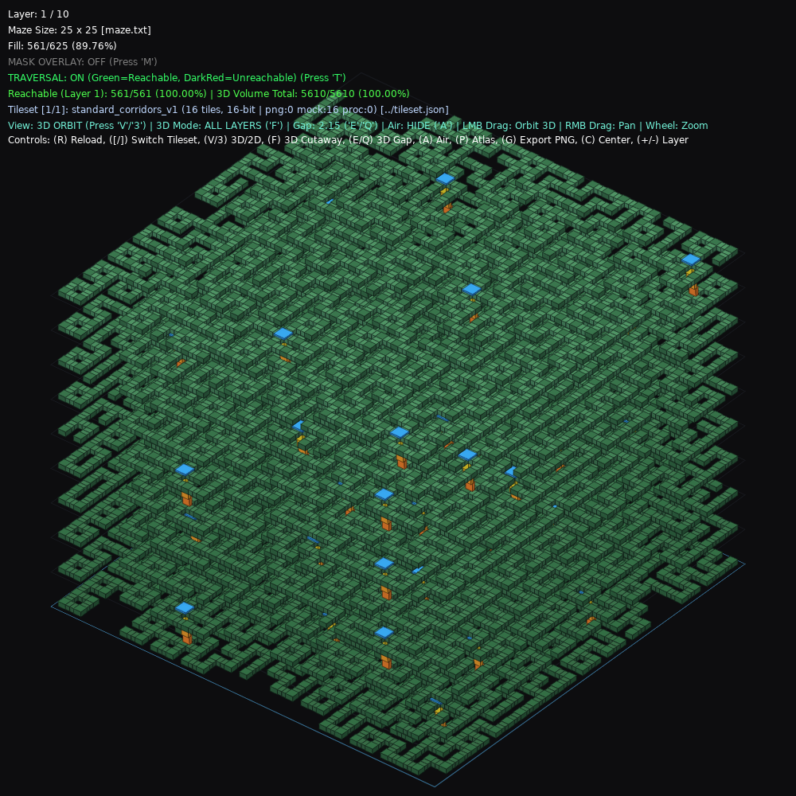
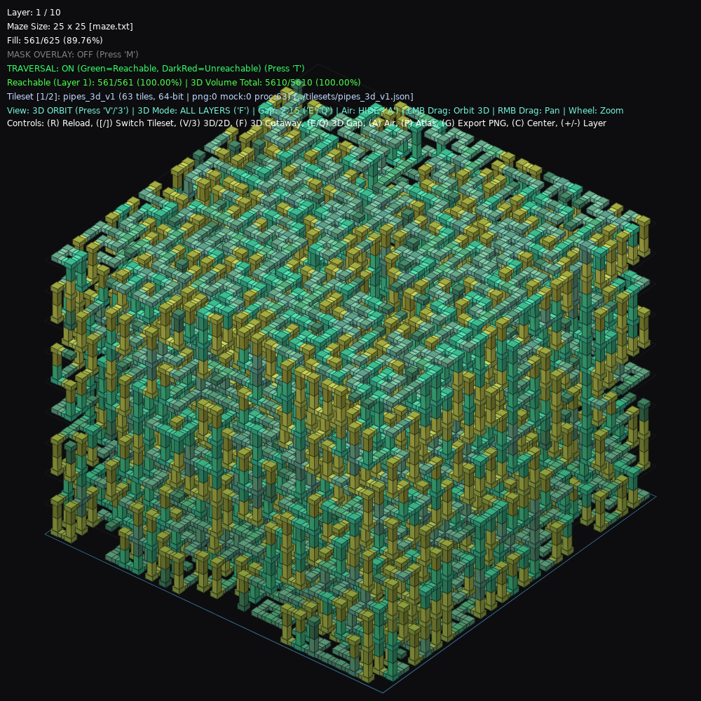

# TALOS (Topological Adjacency Lattice & Orthogonal Solver)

Fast, multithreaded 2D/3D Wave Function Collapse and topology solver written in C11. Originally built as the native map generation backend for **Escape from Ganivi**, now generalized into a data-driven 6-directional (`N, E, S, W, U, D`) lattice and network solver.

<p align="center">
  
  
</p>
<p align="center">
  
</p>

## How It Works

Standard WFC fills a grid until it hits a contradiction and either backtracks exponentially or crashes, and it has no concept of global path connectivity. TALOS splits local constraint solving from global graph repair so generation runs in strict linear $O(V / P)$ time.

### 1. JSON Rulesets & Compile-Time Baking (`talos_codegen`)
Tile rules, sockets (`N, E, S, W, U, D`), category spawn curves, and vertical area quotas are defined in [`tileset.json`](tileset.json) (a 63-tile 3D pipes example is also included in [`tilesets/pipes_3d_v1.json`](tilesets/pipes_3d_v1.json)).
* **Baked Mode (`.dll` / `.so`):** At build time, `talos_codegen` pre-solves the socket graph into flat bitmask lookup tables (`TALOS_PROP_MASK`, `TALOS_VERT_PROP_MASK`, `TALOS_OPEN_LUT`, `TALOS_CLOSE_LUT`) in `talos_tileset_baked.h` and picks the smallest unsigned integer container (`uint8_t`, `uint16_t`, `uint32_t`, or `uint64_t`) that fits the tile count. Zero file I/O or JSON parsing at runtime.
* **Soft Mode (`generateGrid_Soft` / `--soft`):** Compiles a second separate translation unit (`talos_soft.c`) using a universal `uint64_t` carrier so you can load any JSON ruleset at runtime with bit-for-bit identical output. Because it is a separate compilation unit with its own `_Soft` symbols, baked `generateGrid()` pays zero runtime overhead when you don't use soft mode.

### 2. Ridged Noise Masking & Cavity Pruning
When `fulness < 100%`, the engine carves an organic silhouette before WFC runs:
* **Domain-Warped Ridged Noise:** Generates connected veins and corridors instead of round blobs, using a histogram bucket cutoff to select the top `N%` pixels in $O(W \cdot L)$.
* **Sanitize & Rescue:** An iterative BFS keeps only the largest connected landmass and deletes floating islands, then dilates the mask back up to the target density.
* **Unfillable Cavity Pruning:** A single-queue BFS strips out 1-tile pockets or dead twigs where Void boundary rules would leave zero valid tiles.

### 3. Stratified Area Quotas (`runArchitect`)
Before spawning solver threads, the Architect enforces `"vertical_rules"` / `"area_quotas"` from the JSON ruleset:
* Splits each layer into $N \times N$ sectors and places the required number of vertical connectors (e.g. stairs) per sector while respecting minimum spacing and `allow_stacking`.
* Clamps the cells above and below through `TALOS_VERT_PROP_MASK` (for example forcing `Normal_X_Corridor` above `Special_X_Corridor` and blocking stairs on the top floor).
* Guarantees at least one valid connection between every adjacent floor `z` and `z + 1`.

### 4. 4-Color Checkerboard 3D Column WFC
Instead of running one thread per layer (which leaves cores idle on 1-layer maps and prevents true 3D vertical propagation), the grid is partitioned into vertical 3D columns ($B \times B \times H$) colored in 4 phases (Red, Blue, Green, Yellow):
* Chunks of the same color share no orthogonal borders and are solved in parallel across the worker pool with zero mutexes or atomic locks during propagation.
* Each worker uses a chunk-scoped binary min-heap (`ChunkHeap3D`) and hardware bit intrinsics (`POPCNT` / `TZCNT`) for 1-cycle 6-directional domain intersection.
* **Gaussian Category Pacing:** As each column collapses, category weights shift along a Gaussian curve (`curve_pos`, `connector_boost`) from hubs (`X`) to branches (`T, L, I`) to dead ends (`D`).
* **Lifeguard Recovery:** If a cell hits 0 candidates where two wavefronts meet, it recovers against Void/boundary constraints instead of crashing.

### 5. Ariadne Topological Welder
After WFC finishes, disconnected regions are welded into a single 100%-traversable graph:
* **Seam & Boundary Healing:** `TALOS_CLOSE_LUT` and `TALOS_OPEN_LUT` close any ports facing Void/map borders and make interior walls symmetric in $O(1)$ per cell.
* **1-Bit Ariadne Quotient-Prim Welder:** Replaces Kruskal/Union-Find region IDs with a single in-place visited bit (`TALOS_VISITED_BIT`). Expands connected regions via BFS and punches walls across the frontier until 100% of the map (in 2.5D layers or full 6D 3D pipe networks) is reachable.

---

## Writing Your Own Tileset JSON

Look at [`tileset.json`](tileset.json) (2.5D corridors with stairs) and [`tilesets/pipes_3d_v1.json`](tilesets/pipes_3d_v1.json) (63-tile 3D pipes) for full working examples.

**Hard engine limits:** max `64` tiles, `16` sockets, `16` categories, `8` vertical area quotas.

A ruleset has 5 top-level sections:

```json
{
  "name": "my_tileset",
  "dimensions": 3,
  "sockets": {
    "WALL":       { "open": false, "allow_void": true,  "compatible": ["WALL"] },
    "OPEN":       { "open": true,  "allow_void": false, "compatible": ["OPEN"] },
    "CEIL_SOLID": { "open": false, "allow_void": true,  "compatible": ["FLOOR_SOLID", "FLOOR_X"] },
    "FLOOR_SOLID":{ "open": false, "allow_void": true,  "compatible": ["CEIL_SOLID"] },
    "STAIR_UP":   { "open": true,  "allow_void": false, "compatible": ["FLOOR_X"] },
    "FLOOR_X":    { "open": false, "allow_void": true,  "compatible": ["CEIL_SOLID", "STAIR_UP"] }
  },
  "categories": [
    { "name": "HUB",    "curve_pos": 0.0, "mask_weight": 0.10, "connector_boost": false, "natural_spawn": true },
    { "name": "HALL",   "curve_pos": 2.0, "mask_weight": 0.80, "connector_boost": true,  "natural_spawn": true },
    { "name": "DEAD",   "curve_pos": 4.0, "mask_weight": 0.10, "connector_boost": false, "natural_spawn": true },
    { "name": "STAIRS", "curve_pos": 0.0, "mask_weight": 0.00, "connector_boost": false, "natural_spawn": false }
  ],
  "gaussian_config": { "gauss_width": 2.0, "connector_boost": 2.5 },
  "vertical_rules": {
    "seed_tile": "Hub_4Way",
    "default_up_socket": "CEIL_SOLID",
    "default_down_socket": "FLOOR_SOLID",
    "guarantee_layer_connection": true,
    "area_quotas": [
      {
        "tile": "Stairs_Up",
        "area_size": 20,
        "count_per_area": 1,
        "min_per_layer": 2,
        "min_spacing": 2,
        "allow_stacking": false
      }
    ]
  },
  "tiles": [
    { "id": 0, "name": "Hub_4Way",  "category": "HUB",    "ports": { "N": "OPEN", "E": "OPEN", "S": "OPEN", "W": "OPEN", "D": "FLOOR_X" }, "weld_target": true },
    { "id": 1, "name": "Stairs_Up", "category": "STAIRS", "ports": { "N": "OPEN", "E": "OPEN", "S": "OPEN", "W": "OPEN", "U": "STAIR_UP" }, "weld_target": false }
  ]
}
```

What each part controls:
* **`sockets`**:
  * `open`: `true` if traversable/weldable by the Ariadne welder, `false` for solid walls/terrain.
  * `allow_void`: `true` if this face is allowed to touch Void (`0`) or the outer edges of the grid (top ceiling, bottom floor, perimeter). Defaults to `!open`.
  * `compatible`: list of socket names this socket can connect to on the neighboring tile's opposite face (`N<->S`, `E<->W`, `U<->D`).
* **`categories` & `gaussian_config`**:
  * `curve_pos`: position along the Gaussian pacing sweep used in `100%` Ocean Mode (smaller values spawn earlier near seeds, larger values spawn later toward edges).
  * `mask_weight`: fixed spawn weight used in `< 100%` Mask Mode (and for multi-socket or 3D-pipe tilesets).
  * `connector_boost`: if `true`, gets an extra weight boost early in Ocean Mode that fades out as the grid fills.
  * `natural_spawn`: set to `false` for quota-only tiles like stairs so WFC never spawns them randomly.
* **`vertical_rules`**:
  * `seed_tile`: preferred starting tile when seeding a chunk or layer center.
  * `default_up_socket` / `default_down_socket`: default `U` and `D` sockets applied to any tile that omits them in `ports`.
  * `guarantee_layer_connection`: if `true`, forces at least one vertical connector between every pair of layers `z` and `z + 1` even on sparse noise masks.
  * `area_quotas`: places `count_per_area` copies of `tile` inside every `area_size x area_size` sector (with at least `min_per_layer` per floor, `min_spacing` cells apart, and optional `allow_stacking`).
* **`tiles`**:
  * `id`: unique `0 .. N-1` bit index (tile value in the returned grid is `1 << id`).
  * `ports`: socket names for `N, E, S, W` and optional `U, D`.
  * `weld_target`: defaults to `true`. Set to `false` on special/quota tiles so the welder never morphs a normal corridor into a staircase.
* **2-socket vs. multi-socket rulesets:** Rulesets with `<= 2` distinct horizontal sockets (e.g. `WALL` + `OPEN` mazes and 3D pipes) automatically run the **4-Color Checkerboard 3D Column Pool + Ariadne Welder** for 100% connectivity. Rulesets with `> 2` horizontal sockets (e.g. terrain/castle/texture Wang tiles) run AC-3 union propagation with local patch backtracking instead of corridor welding.

---

## Build

Requires a C11 compiler and CMake 3.15+. `tinycthread` is bundled in the repo.

```bash
mkdir build
cd build
cmake ..
cmake --build .
```

CMake options:
* `-DTALOS_TILESET_FILE=path/to/custom.json`: bake a different JSON tileset into the shared library at build time (default: `tileset.json`)
* `-DTALOS_ENABLE_SOFT=ON|OFF`: include the runtime `--soft` JSON API (`talos_soft_load_ruleset` / `generateGrid_Soft`) in the shared library (default: `ON`, zero performance impact on baked `generateGrid`)
* `-DTALOS_BUILD_CLI=ON`: also build the standalone `debug_gen` CLI executable
* `-DTALOS_BUILD_TESTS=ON`: build the verification & benchmark test suite (`talos_tests`, runnable via `ctest`)

---

## C API & Bindings

`generateGrid` returns a 3D array `grid[z][y][x]` of `talos_tile_t` (`uint16_t` for the default 16-tile ruleset). `0` (`Empty_Tile`) is Void; any non-zero value is a single set bit (`1 << tile_id`). All cells live in one contiguous flat buffer starting at `grid[0][0]`.

### C (Baked & Runtime Soft Mode)
```c
#include "generator.h"
#include "talos_soft.h" // only needed if loading JSON at runtime

// Baked mode (zero runtime overhead, uses tileset baked at build time)
talos_tile_t ***map = generateGrid(50, 50, 5, 12345, 70);
if (map) {
    talos_tile_t tile = map[0][10][10];
    freeGrid(map, 50, 50, 5);
}

// Soft mode (load any JSON ruleset at runtime into a uint64_t grid)
if (talos_soft_load_ruleset("tilesets/pipes_3d_v1.json")) {
    uint64_t ***pipes = generateGrid_Soft(25, 25, 6, 42, 70);
    if (pipes) {
        uint64_t tile = pipes[0][10][10];
        freeGrid_Soft(pipes, 25, 25, 6);
    }
}
```

### C# (Unity)
```csharp
using System;
using System.Runtime.InteropServices;

public class MazeGen
{
    [DllImport("libTALOS")]
    private static extern IntPtr generateGrid(uint width, uint length, uint height, uint seed, uint fullness);

    [DllImport("libTALOS")]
    private static extern void freeGrid(IntPtr grid, uint width, uint length, uint height);

    public void Create()
    {
        uint w = 50, l = 50, h = 5;
        IntPtr gridPtr = generateGrid(w, l, h, 12345, 70);
        if (gridPtr != IntPtr.Zero)
        {
            // unmarshal IntPtr layers/rows (or read flat buffer at grid[0][0]) to ushort[,,]
            freeGrid(gridPtr, w, l, h);
        }
    }
}
```

### Python (`ctypes`)
```python
import ctypes
from ctypes import c_uint32, c_uint16, POINTER

lib = ctypes.CDLL("./libTALOS.so")  # Windows: ./libTALOS.dll

ThreeDArray = POINTER(POINTER(POINTER(c_uint16)))
lib.generateGrid.restype = ThreeDArray
lib.generateGrid.argtypes = [c_uint32] * 5
lib.freeGrid.argtypes = [ThreeDArray, c_uint32, c_uint32, c_uint32]

w, l, h = 50, 50, 5
grid = lib.generateGrid(w, l, h, 12345, 70)
print("Tile at [0][10][10]:", grid[0][10][10])
lib.freeGrid(grid, w, l, h)
```

---

## Debug Runner & LÖVE2D 3D Visualizer (`debug/`)

The [`debug/`](debug) folder contains the standalone CLI runner (`debug/main.c`) and a LÖVE2D visualizer (`debug/main.lua`) with both a 2D slice view and an interactive 3D orbit view + 3D flood-fill reachability checker.

```bash
# Baked default tileset (25x25x10, seed 5, 70% fullness)
./debug/debug.sh

# Custom dimensions, seed, and fullness
./debug/debug.sh --size 60x60x5 --seed 42 --fullness 80

# Soft mode with the 63-tile 3D pipes ruleset (no C recompile needed)
./debug/debug.sh --soft tilesets/pipes_3d_v1.json --size 25x25x6 --seed 5 -f 70
```

CLI flags: `--size WxLxH` (or `-w`, `-l`, `-z`/`--layers`), `--seed N|random`, `-f`/`--fullness N`, `-s`/`--soft PATH`, `-d`/`--talos-debug`, `--talos-debug-quick`, `--help`.

**Visualizer Controls:**
* `V` / `3`: Toggle 3D Orbit View / 2D Slice View (LMB drag to orbit, RMB drag to pan, wheel to zoom)
* `F`: Cycle 3D cutaway modes (All Layers / Cutaway $\le$ Current Layer / Highlight Layer)
* `E` / `Q`: Increase / decrease vertical gap between 3D layers
* `+` / `-`: Step current Z layer up / down
* `T`: Toggle 3D flood-fill reachability overlay
* `M`: Toggle noise mask overlay
* `P`: Inspect tileset atlas & socket table

---

## Tests & Benchmarks (`tests/`)

[`tests/test_talos.c`](tests/test_talos.c) verifies Baked vs. Soft bit-for-bit parity, 2D/3D socket validity, 6-face Void closure, stair alignment, and 100% 3D flood-fill reachability across `100%`, `70%`, and `45%` fullness on both `tileset.json` and `tilesets/pipes_3d_v1.json`.

Run via CMake (`-DTALOS_BUILD_TESTS=ON` + `ctest`) or directly with `gcc`:

```bash
gcc -std=c11 -O3 -D_GNU_SOURCE tests/test_talos.c generator.c talos_debug.c talos_utils.c talos_noise.c talos_topology.c talos_solver.c talos_ruleset.c talos_soft.c tinycthread/tinycthread.c -I. -Itinycthread -lm -lpthread -o talos_tests
./talos_tests          # full 5-seed benchmark + verification
./talos_tests --quick  # 1-seed fast sanity check
```

### Performance & Complexity

* **Time Complexity:** $\Theta(V / P)$ linear in total grid volume $V = W \cdot L \cdot H$ across $P$ worker threads.
* **Memory Complexity:** $\Theta(V)$ total ($2\text{ bytes/cell}$ in 16-tile Baked mode = `~408 KB` grid for `200,000` cells), with chunk-scoped heaps ($\sim 160\text{ KB/thread}$) that stay in L2 cache.

| Configuration | Cells | Fullness | Avg Time (8 Threads) | 3D Reachability |
| :--- | ---: | :---: | ---: | :---: |
| `25x25x6` (3D Pipes, 63 tiles) | `3,750` | `70%` | `~1.76 ms` | `100.0%` |
| `50x50x10` (10-Floor Maze) | `25,000` | `70%` | `~4.19 ms` | `100.0%` |
| `200x200x1` (1-Layer Parallel Maze) | `40,000` | `100%` | `~3.92 ms` | `100.0%` |
| `200x200x5` (5-Floor Maze) | `200,000` | `70%` | `~15.17 ms` | `100.0%` |
| `200x200x5` (5-Floor Maze) | `200,000` | `100%` | `~16.76 ms` | `100.0%` |
