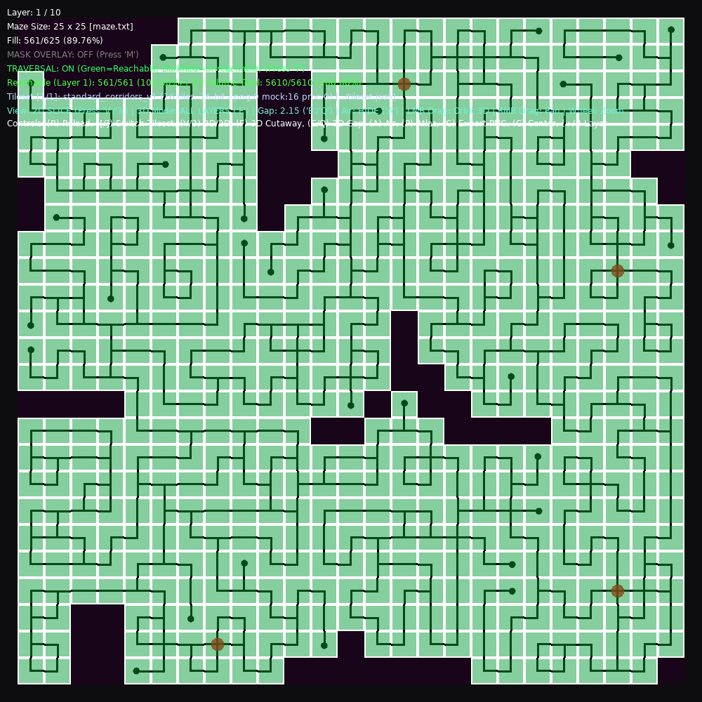

# CGSME (Coherent Guided Stochastic Maze Engine)

Fast, multithreaded 2D/3D Wave Function Collapse and maze topology engine written in C11. Originally built as the native map generation backend for **Escape from Ganivi**, now generalized into a data-driven 6-directional (`N, E, S, W, U, D`) solver.

<p align="center">
  
  
</p>
<p align="center">
  
</p>

## How It Works

Standard WFC fills a grid until it hits a contradiction and either backtracks exponentially or crashes, and it has no concept of global path connectivity. CGSME splits local constraint solving from global graph repair so generation runs in strict linear $O(V / P)$ time.

### 1. JSON Rulesets & Compile-Time Baking (`cgsme_codegen`)
Tile rules, sockets (`N, E, S, W, U, D`), category spawn curves, and vertical area quotas are defined in [`tileset.json`](tileset.json).
* **Baked Mode (`.dll` / `.so`):** At build time, `cgsme_codegen` pre-solves the socket graph into flat bitmask lookup tables (`CGSME_PROP_MASK`, `CGSME_VERT_PROP_MASK`, `CGSME_OPEN_LUT`, `CGSME_CLOSE_LUT`) in `cgsme_tileset_baked.h` and picks the smallest unsigned integer container (`uint8_t`, `uint16_t`, `uint32_t`, or `uint64_t`) that fits the tile count. Zero file I/O or JSON parsing at runtime.
* **Soft Mode (`--soft`):** The standalone debug runner can also load any JSON ruleset at runtime using a universal `uint64_t` carrier with bit-for-bit identical output, so you can tweak rulesets and preview them without recompiling C.

### 2. Ridged Noise Masking & Cavity Pruning
When `fulness < 100%`, the engine carves an organic silhouette before WFC runs:
* **Domain-Warped Ridged Noise:** Generates connected veins and corridors instead of round blobs, using a histogram bucket cutoff to select the top `N%` pixels in $O(W \cdot L)$.
* **Sanitize & Rescue:** An iterative BFS keeps only the largest connected landmass and deletes floating islands, then dilates the mask back up to the target density.
* **Unfillable Cavity Pruning:** A single-queue BFS strips out 1-tile pockets or dead twigs where Void boundary rules would leave zero valid tiles.

### 3. Stratified Area Quotas (`runArchitect`)
Before spawning solver threads, the Architect enforces `"vertical_rules"` / `"area_quotas"` from the JSON ruleset:
* Splits each layer into $N \times N$ sectors and places the required number of vertical connectors (e.g. stairs) per sector while respecting minimum spacing and `allow_stacking`.
* Clamps the cells above and below through `CGSME_VERT_PROP_MASK` (for example forcing `Normal_X_Corridor` above `Special_X_Corridor` and blocking stairs on the top floor).
* Guarantees at least one valid connection between every adjacent floor `z` and `z + 1`.

### 4. 4-Color Checkerboard 3D Column WFC
Instead of running one thread per layer (which leaves cores idle on 1-layer maps and prevents true 3D vertical propagation), the grid is partitioned into vertical 3D columns ($B \times B \times H$) colored in 4 phases (Red, Blue, Green, Yellow):
* Chunks of the same color share no orthogonal borders and are solved in parallel across the worker pool with zero mutexes or atomic locks during propagation.
* Each worker uses a chunk-scoped binary min-heap (`ChunkHeap3D`) and hardware bit intrinsics (`POPCNT` / `TZCNT`) for 1-cycle 6-directional domain intersection.
* **Gaussian Category Pacing:** As each column collapses, category weights shift along a Gaussian curve (`curve_pos`, `connector_boost`) from hubs (`X`) to branches (`T, L, I`) to dead ends (`D`).
* **Lifeguard Recovery:** If a cell hits 0 candidates where two wavefronts meet, it recovers against Void/boundary constraints instead of crashing.

### 5. Ariadne Topological Welder
After WFC finishes, disconnected regions are welded into a single 100%-traversable graph:
* **Seam & Boundary Healing:** `CGSME_CLOSE_LUT` and `CGSME_OPEN_LUT` close any ports facing Void/map borders and make interior walls symmetric in $O(1)$ per cell.
* **1-Bit Ariadne Quotient-Prim Welder:** Replaces Kruskal/Union-Find region IDs with a single in-place visited bit (`CGSME_VISITED_BIT`). Expands connected regions via BFS and punches walls across the frontier until 100% of the map (in 2.5D layers or full 6D 3D pipe networks) is reachable.

---

## Build

Requires a C11 compiler and CMake 3.15+. `tinycthread` is bundled in the repo.

```bash
mkdir build
cd build
cmake ..
cmake --build .
```

To bake a custom JSON tileset into the shared library at build time:

```bash
cmake .. -DCGSME_TILESET_FILE=path/to/your_tileset.json
cmake --build .
```

---

## C API & Bindings

`generateGrid` returns a 3D array `grid[z][y][x]` of `cgsme_tile_t` (`uint16_t` for the default 16-tile ruleset). `0` (`Empty_Tile`) is Void; any non-zero value is a single set bit (`1 << tile_id`).

### C
```c
#include "generator.h"

uint32_t width = 50, length = 50, height = 5;
uint32_t seed = 12345, fullness = 70;

cgsme_tile_t ***map = generateGrid(width, length, height, seed, fullness);
if (map) {
    cgsme_tile_t tile = map[0][10][10];
    // use map...
    freeGrid(map, width, length, height);
}
```

### C# (Unity)
```csharp
using System;
using System.Runtime.InteropServices;

public class MazeGen
{
    [DllImport("libCGSME")]
    private static extern IntPtr generateGrid(uint width, uint length, uint height, uint seed, uint fullness);

    [DllImport("libCGSME")]
    private static extern void freeGrid(IntPtr grid, uint width, uint length, uint height);

    public void Create()
    {
        uint w = 50, l = 50, h = 5;
        IntPtr gridPtr = generateGrid(w, l, h, 12345, 70);
        if (gridPtr != IntPtr.Zero)
        {
            // unmarshal IntPtr layers/rows to ushort[,,]
            freeGrid(gridPtr, w, l, h);
        }
    }
}
```

### Python (`ctypes`)
```python
import ctypes
from ctypes import c_uint32, c_uint16, POINTER

lib = ctypes.CDLL("./libCGSME.so")  # Windows: ./libCGSME.dll

ThreeDArray = POINTER(POINTER(POINTER(c_uint16)))
lib.generateGrid.restype = ThreeDArray
lib.generateGrid.argtypes = [c_uint32] * 5
lib.freeGrid.argtypes = [ThreeDArray, c_uint32, c_uint32, c_uint32]

w, l, h = 50, 50, 5
grid = lib.generateGrid(w, l, h, 12345, 70)
print("Tile at [0][10][10]:", grid[0][10][10])
lib.freeGrid(grid, w, l, h)
```

---

## Debug Runner & LÖVE2D 3D Visualizer (`debug/`)

The [`debug/`](debug) folder contains the standalone CLI runner (`debug/main.c`) and a LÖVE2D visualizer (`debug/main.lua`) with both a 2D layer slice view and an interactive 3D orbit view + 3D flood-fill reachability checker.

```bash
# Compile baked mode, generate maze.txt, and open the visualizer
./debug/debug.sh

# Run in --soft mode with any custom JSON ruleset (no C recompile needed)
./debug/debug.sh --soft path/to/tileset.json
```

**Visualizer Controls:**
* `V` / `3`: Toggle 3D Orbit View / 2D Slice View (LMB drag to orbit, RMB drag to pan, wheel to zoom)
* `F`: Cycle 3D cutaway modes (All Layers / Cutaway $\le$ Current Layer / Highlight Layer)
* `E` / `Q`: Increase / decrease vertical gap between 3D layers
* `+` / `-`: Step current Z layer up / down
* `T`: Toggle 3D flood-fill reachability overlay
* `M`: Toggle noise mask overlay
* `P`: Inspect tileset atlas & socket table

---

## Performance & Complexity

* **Time Complexity:** $\Theta(V / P)$ linear in total grid volume $V = W \cdot L \cdot H$ across $P$ worker threads.
* **Memory Complexity:** $\Theta(V)$ total ($2\text{ bytes/cell}$ in 16-tile Baked mode = `~408 KB` grid for `200,000` cells), with chunk-scoped heaps ($\sim 160\text{ KB/thread}$) that stay in L2 cache.

| Configuration | Cells | Fullness | Avg Time (8 Threads) | 3D Reachability |
| :--- | ---: | :---: | ---: | :---: |
| `25x25x6` (3D Pipes, 63 tiles) | `3,750` | `70%` | `~1.76 ms` | `100.0%` |
| `50x50x10` (10-Floor Maze) | `25,000` | `70%` | `~4.19 ms` | `100.0%` |
| `200x200x1` (1-Layer Parallel Maze) | `40,000` | `100%` | `~3.92 ms` | `100.0%` |
| `200x200x5` (5-Floor Maze) | `200,000` | `70%` | `~15.17 ms` | `100.0%` |
| `200x200x5` (5-Floor Maze) | `200,000` | `100%` | `~16.76 ms` | `100.0%` |
